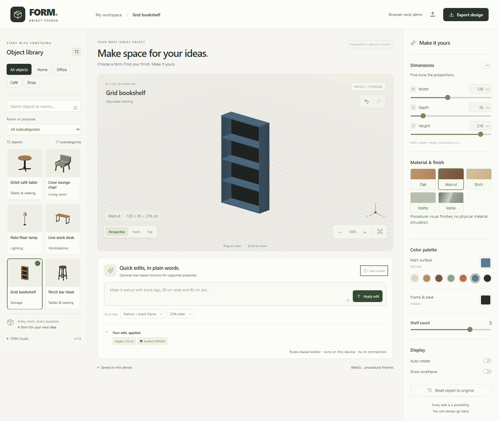

# FORM — Object Studio v1.0

A browser-only studio for exploring and customizing **72 parametric 3D objects**, organized into four categories and 17 subcategories. No account, API key, paid service, or AI connection is required.



## What you can do

- Browse Home, Office, Café and Shop collections; search names, categories, rooms and aliases.
- Orbit, zoom, fit, and inspect front/top/isometric views using WebGL, with an interactive software fallback.
- Edit dimensions in centimeters, surface/frame colors, and procedural wood, matte and metal finishes. Change shape or shelf count only where the selected object supports it.
- Undo/redo, reset, save the current design in this browser, and export/import validated version-1 FORM JSON files (under 100 KB).
- Use the optional **rules-based editor** for supported shortcuts such as `walnut with black legs`, `90 cm wide`, or `20% taller`. It is a local parser and makes no model requests.

Dimensions describe the mesh's outer bounds. Materials are visual approximations; the software fallback uses simplified shading. This is an interactive customization demo, **not CAD, manufacturing output, structural analysis, or physical material simulation**. Some catalog details are stylized and intersect as assembled components.

## Local development

Use Node.js **22.13 or newer** (Node 24 recommended). npm installs only the pinned browser test tooling; the app and build use Node built-ins and browser modules.

```sh
npm ci --ignore-scripts
npm run dev
```

Open **http://127.0.0.1:5173/**. Source changes rebuild `dist/`; reload the browser to see them. Stop with Ctrl+C. No `.env` configuration is needed or read by v1.

```sh
npm test                 # catalog, geometry, camera, state, storage, HTTP/build regressions
npm run check            # JavaScript syntax (v1 contains no TypeScript source)
npm run build            # deterministic static output in dist/
npm run preview          # serve the production build on 127.0.0.1:5173
npm run check:secrets     # tracked files + build, without printing secret values
npm audit
npx playwright install chromium
npm run test:browser      # Chromium desktop, tablet, mobile + failure/fallback cases
```

On Linux CI, install the browser with `npx playwright install --with-deps chromium`. A validation-only GitHub Actions workflow is included. It does not deploy. Browser reports/traces are ignored. The built app itself works with zero installed npm packages; `npm ci` is for repeatable development tests.

## Controls and saving

- Drag the canvas with a pointer or one finger to orbit; scroll to zoom. Use `+`/`−` buttons, Fit, and camera presets. Pinch zoom is not implemented.
- Focus the canvas and use arrow keys to orbit and `+`/`−` to zoom. Tab reaches editing controls and buttons. Use Ctrl/Cmd+Z to undo and Ctrl/Cmd+Shift+Z or Ctrl/Cmd+Y to redo outside text inputs.
- A range drag previews changes and commits one history step on release. Numeric fields apply on Enter/blur; supported limits are shown by the inputs. Auto-rotate starts off, including with reduced-motion preferences. It runs only when explicitly enabled and pauses rendering while the page is hidden.
- Saving stores one current design at `form-studio.workspace.v1` for this browser origin. Switching objects is undoable. Clearing site data removes that saved design; JSON export is the portable backup. If storage is blocked/full or saved JSON is corrupt, the UI reports it instead of claiming a save. Corrupt data is retained until the next successful edit/save.
- Existing valid version-1 exports, including the original eight objects, still import. Unknown IDs, invalid fields/units and oversized files are rejected without replacing the current design. Missing optional legacy fields take catalog defaults; unknown descriptive metadata is ignored.

## Static deployment

| Hosting setting | Value |
| --- | --- |
| Build command | `npm run build` |
| Output directory | `dist` |
| Runtime/server/API | None |
| Environment variables/secrets | None |
| SPA rewrites | None — unknown paths must return 404 |

Publish **only the contents of `dist/`** with a static host. Relative asset paths support a domain root and a GitHub Pages repository subpath; the tests run the build under `/FORM_Studio/`. The build does not copy source directories, history, `.env.local`, private Site identity, or deferred AI code. A CSP in the HTML blocks network API connections; `_headers` adds matching security headers on hosts that support that format. GitHub Pages uses the HTML CSP but does not process `_headers`.

For GitHub Pages, use GitHub Actions as the Pages source, run the checks/build above, and upload **`dist`** as the Pages artifact in a deployment workflow. Follow [GitHub's custom workflow guide](https://docs.github.com/en/pages/getting-started-with-github-pages/using-custom-workflows-with-github-pages). A deployment workflow is intentionally not enabled until the repository/hosting destination is chosen. For other static hosts, select their static/no-framework preset and the build/output settings above. Do not point a host at the repository root or enable a fallback that serves `index.html` for `/api/design`.

No GitHub repository or hosting destination has been supplied, so this release is prepared locally and has not been pushed or published. The existing private hosted Site and its audience were not changed; `.openai/` remains local and ignored.

## Source and future work

- `public/studio/`: maintained editor HTML, CSS and browser modules.
- `scripts/`: static build/preview and syntax/secret checks.
- `tests/`: Node tests and production-build Playwright regressions.
- `docs/v1-release-plan.md`, `docs/v1-verification.md`: implementation and release evidence.
- `docs/dependency-audit-v1.json`: final registry audit snapshot.

The pre-v1 source, including Prompt to Design, its server adapter, tests and old deployment integration, is preserved in commit **`f989f90`** and local branch **`archive/pre-v1-ai`**. Use a separate worktree/checkout to revisit it; its old dependencies need a new security review and its old setup documents are historical. It is absent from the v1 working source and public build. Existing ignored local secrets have been left untouched and are unnecessary for v1.

## Limitations and licensing

The browser suite uses Chromium with desktop/tablet/mobile emulation. It is not a certification for every GPU, real touch device, Safari or Firefox; see the verification document for remaining manual checks. Objects are fixed catalog templates, not arbitrary meshes. There are no cloud accounts, multi-user workspaces or project lists.

No new project license has been chosen. The catalog/editor were retained from the supplied project; ownership of that existing work has not been independently established. Confirm rights and choose licensing before granting reuse rights. No third-party images, fonts or model assets were added. Playwright is development-only and retains its upstream Apache-2.0 license; the archived hosting template's original license remains in Git history.
