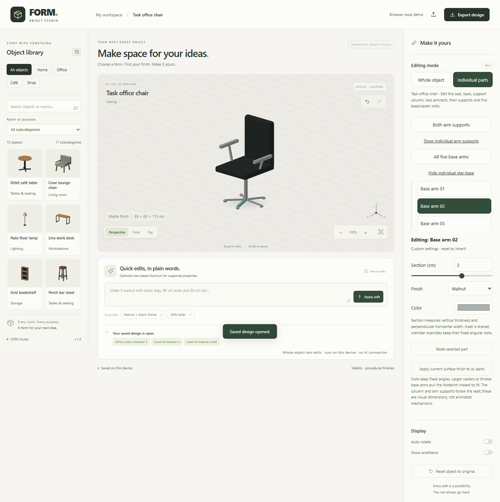

# FORM — Object Studio v1.8

A browser-only studio for exploring and customizing **72 parametric 3D objects**, organized into four categories and 17 subcategories. No account, API key, paid service, or AI connection is required.



## What you can do

- Browse Home, Office, Café and Shop collections; search names, categories, rooms and aliases.
- Orbit, zoom, fit, and inspect front/top/isometric views using WebGL, with an interactive software fallback.
- Edit dimensions in centimeters, surface/frame colors, and procedural wood, matte and metal finishes. Change shape or shelf count only where the selected object supports it.
- Use **Individual parts** on twenty-four objects: twelve tables/desks/stands, Cove lounge chair, Meeting chair, Dining chair, Visitor chair, Outdoor chair, Perch bar stool and Breakfast stool, plus Garden bench, Café bench, Studio sofa, Reception sofa and Task office chair. Edit linked groups or individual members. The remaining 48 objects keep whole-object editing.
- Undo/redo, reset, save the current design in this browser, and export version-3 FORM JSON files (under 100 KB). Version-1 and version-2 files still import.
- Use the optional **rules-based editor** for supported shortcuts such as `walnut with black legs`, `90 cm wide`, or `20% taller`. It is a local parser and makes no model requests.

Dimensions describe the mesh's outer bounds. Materials are visual approximations; the software fallback uses simplified shading. This is an interactive customization demo, **not CAD, manufacturing output, structural analysis, or physical material simulation**. Some catalog details are stylized and intersect as assembled components.

## Parts Editor: tables and desks

Choose **Orbit café table**, **Round side table** or **Square café table → Individual parts**. Edit the tabletop's width, depth, round/oval or rectangular shape and thickness; the column's diameter; and the base assembly's width/depth. Every component has an independent visual finish and color. Column height follows the overall height and tabletop underside; the base remains grounded and its footprint stays within the tabletop. Return to **Whole object** to change total height. Input limits may adjust dependent dimensions, shown in edit feedback. Component dimensions use centimeters with decimal input. Each table uses its own catalog sizes and finishes; switching tables does not copy custom settings to the new object.

Parts without custom settings inherit their defaults: the top uses the main surface finish/color; support and feet use the frame color with a matte finish. Whole-object finish edits preserve explicit part overrides. **Apply current surface finish to all parts** explicitly assigns the main surface finish/color to each component. **Reset selected part** removes its overrides; **Reset object** restores the catalog default. A part can contain several geometric pieces: all four feet are one base assembly.

For the five standard desks/tables, choose **All legs** or **Both feet** for linked settings. Expand the group or click a visible member to customize a particular leg or foot. Leg section and shared inset, foot width/depth/thickness, top thickness and brace section have constrained dimensions. A member can have its own size, finish and color. Group edits preserve custom members; **Apply group settings to all members** clears their overrides, while **Reset group and members** clears both the group and its descendants. These operations are undoable. The parts list scrolls independently to keep controls reachable.

Legs attach to their corresponding grounded foot and the underside of the top; the brace follows the rear supports. Round/oval tops pull supports inward to stay attached. Overall dimensions remain authoritative, and changing thickness adjusts support lengths. These are visual assembly rules, not structural analysis or joinery simulation.

The standing desk exposes two columns and two feet with linked/individual controls. The corner desk keeps two flush L-shaped slabs and five supports: Joined tops controls shared thickness, main slab width and return slab depth; expand it for separate finishes. The patio table has seven fixed slats with shared thickness/gap and individual finishes; round shape clips those same slats to an oval. Its supports stay under slats when gap changes. The laptop stand exposes the platform, angled support, base and retaining lip; lip height counts toward total height and all connections follow dimension edits. Legacy whole-object v1/v2/v3 exports for these objects migrate to their revisioned profiles. Their geometry now uses explicit final dimensions rather than the old global rescale, so support placement/grounding may differ.

Drag to orbit, click/tap to select, and press Escape with the canvas or parts inspector focused to clear selection. Selection pauses auto-rotation, is temporary, and creates no undo entry. A slider drag creates one edit. The list also provides keyboard access to components hidden behind others. Software fallback supports the same editing/selection workflow with simplified shading. The rules-based text editor applies to whole-object settings; use the inspector for component dimensions.

All twenty-four parts-enabled objects use final component dimensions instead of globally rescaling the mesh. Legacy settings retain dimensions and finishes; converted models can have documented grounding/support-layout differences. All twenty-three previously released parts-enabled meshes remain unchanged, including custom café-table geometry. Other 48 objects retain their original geometry. Free movement, adding/removing components, separate plywood layers, exploded views and other object families are future work. See [all-object rollout plan](docs/parts-editor-all-objects-plan.md).

See the [R1 release notes](docs/parts-editor-r1-release.md) for the four construction profiles, constraints and compatibility checks.

## Parts Editor: chairs and stools

Choose one of the seven supported chairs/stools, then **Individual parts**. Chairs expose seat top height and thickness, backrest thickness, and four splayed legs. Armchairs also expose linked/individual armrest height and section; their supports follow the seat and matching armrest and have independent finishes. Dining and Visitor chairs expose no arm controls. Outdoor chair keeps five back slats with shared thickness/gap and individual finishes. Stools expose seat shape/thickness, four legs, shared stretcher height and independent stretcher sections/finishes.

Seat top height is measured from the floor. Thickness adjusts the leg endpoints; backrests stay attached and reach total height. Leg section measures a horizontal cross section, not the bounding width of a slanted leg. Group edits preserve custom members until Apply group settings or Reset group and members. All edits remain inside whole-object dimensions. Whole-object v1/v2/v3 seating saves migrate, but explicit grounded/connected geometry can differ from the old globally scaled model. No swivel, tilt or recline mechanism is implied. See [R2 release notes](docs/parts-editor-r2-release.md) for parameter limits and compatibility.

## Parts Editor: benches

Garden bench and Café bench expose four seat slats, two seat bearers and four splayed legs. Expand groups to change one board's thickness/finish or one support's section/finish. Seat gap is shared; board depth follows the overall depth. Café seat top is the whole-object height; Garden seat top height has its own control. Garden bench additionally exposes three horizontal back slats with individual height/depth/finish and two back supports. Back spacing follows seat and board heights, with the top board ending at total height.

The two under-seat bearers are a documented correction to the earlier model: they connect all separated seat boards to the legs. Individual thicknesses can differ while the board tops stay level. Bearers meet the thinnest board's underside and overlap thicker boards; leg ends follow each bearer's bottom. All counts stay fixed and v1/v2/v3 whole-object saves still import. See the [R3 plan](docs/parts-editor-r3-plan.md) and [release notes](docs/parts-editor-r3-release.md).

## Parts Editor: sofas and changing counts

Studio sofa and Reception sofa expose the base, backrest, two arms, individual cushions and four legs. **Cushion count** in Individual parts chooses 1–4 stable slots. Increasing count adds inherited members; decreasing removes highest slots and their active overrides. Surviving slots retain custom settings. Undo restores removed slots and settings; re-adding after a committed decrease starts with defaults. A surviving selection stays selected; removing the selected slot chooses All cushions. Count-control focus and group expansion remain stable.

Width changes resize the chosen layout without changing count. Historical whole-object sofas migrate the old two-cushion layout at width ≤190 cm or three above it, using the original width before rounding. New sofa exports explicitly save construction and profile revision; unknown construction, invalid counts and inactive cushion IDs are rejected. Existing fixed profiles retain their saved settings.

Base top height/thickness, back depth, arm height/width, cushion thickness/gap and leg sections stay within the whole-object envelope. Group settings and individual overrides use the existing apply/reset workflow. The shared T0 foundation supports profile-defined dynamic members; shelf/tier adapters and ordered placement remain future family work. See the [T0/R4 plan](docs/parts-editor-t0-r4-plan.md) and [release notes](docs/parts-editor-t0-r4-release.md).

## Parts Editor: office chair

Task office chair exposes seat top height/thickness, back depth, column diameter, two armrests/supports and five fixed base/caster slots. Expand groups to customize armrest height/section, each base-arm section or each caster diameter/finish. Footprint inset is shared. Larger casters and thicker spokes move the base inward to fit; each caster remains grounded and attached to its matching arm. Column height and arm supports follow the seat and armrests.

Caster diameter measures horizontal width/depth; height is 75% of that value. Spoke section measures its vertical thickness and perpendicular horizontal width. The new radial geometry prevents thick spokes dipping below small casters. No count, swivel or tilt mechanism is added. Historical whole-object saves import into the new revisioned profile. See [R5 plan](docs/parts-editor-r5-plan.md) and [release notes](docs/parts-editor-r5-release.md).

## Local development

Use Node.js **22.13 or newer** (Node 24 recommended). npm installs only the pinned browser test tooling; the app and build use Node built-ins and browser modules.

```sh
npm ci --ignore-scripts
npm run dev
```

Open **http://127.0.0.1:5173/**. Source changes rebuild `dist/`; reload the browser to see them. Stop with Ctrl+C. No `.env` configuration is needed or read by v1.

```sh
npm test                 # catalog, geometry, camera, state, storage, HTTP/build regressions
npm run check            # JavaScript syntax (v1 contains no TypeScript source)
npm run build            # deterministic static output in dist/
npm run preview          # serve the production build on 127.0.0.1:5173
npm run check:secrets     # tracked files + build, without printing secret values
npm audit
npx playwright install chromium
npm run test:browser      # Chromium desktop, tablet, mobile + failure/fallback cases
```

On Linux CI, install the browser with `npx playwright install --with-deps chromium`. GitHub Actions validates all changes and deploys verified builds from `main` to GitHub Pages. Pull requests run validation without deploying. Browser reports/traces are ignored. The built app itself works with zero installed npm packages; `npm ci` is for repeatable development tests.

## Controls and saving

- Drag the canvas with a pointer or one finger to orbit; scroll to zoom. Use `+`/`−` buttons, Fit, and camera presets. Pinch zoom is not implemented.
- Focus the canvas and use arrow keys to orbit and `+`/`−` to zoom. Tab reaches editing controls and buttons. Use Ctrl/Cmd+Z to undo and Ctrl/Cmd+Shift+Z or Ctrl/Cmd+Y to redo outside text inputs.
- A range drag previews changes and commits one history step on release. Numeric fields apply on Enter/blur; supported limits are shown by the inputs. Auto-rotate starts off, including with reduced-motion preferences. It runs only when explicitly enabled and pauses rendering while the page is hidden.
- Saving stores one current design at `form-studio.workspace.v3` for this browser origin. If absent, a valid v2 save is migrated, then v1 is considered only if v2 is absent; original backups are retained. A corrupt newer save is reported rather than silently replaced by older data. Switching objects is undoable. Clearing site data removes saved designs; JSON export is the portable backup. If storage is blocked/full or saved JSON is corrupt, the UI reports it instead of claiming a save. Corrupt data is retained until the next successful edit/save.
- Existing valid version-1 exports, including the original eight objects, still import. Unknown IDs, invalid fields/units and oversized files are rejected without replacing the current design. Missing optional legacy fields take catalog defaults; unknown descriptive metadata is ignored.
- New exports use version 3, including independent part overrides and the registered object's `partsRevision`. Unknown/future revisions, part IDs/fields, invalid dimensions/materials/colors, and parts on unsupported objects are rejected. Version-2 café-table settings migrate without changes. Releases before v1.2 cannot read v3 files; v1.2 cannot read the new standard-desk member schemas.
- Earlier v3 whole-object files for the five standard desks, which contain neither `partsRevision` nor `parts`, acquire revision 1 defaults. Member settings require the explicit revision. Older app versions cannot open new desk part schemas.

## Static deployment

| Hosting setting               | Value                                |
| ----------------------------- | ------------------------------------ |
| Build command                 | `npm run build`                      |
| Output directory              | `dist`                               |
| Runtime/server/API            | None                                 |
| Environment variables/secrets | None                                 |
| SPA rewrites                  | None — unknown paths must return 404 |

Publish **only the contents of `dist/`** with a static host. Relative asset paths support a domain root and a GitHub Pages repository subpath; the tests run the build under `/FORM_Studio/`. The build does not copy source directories, history, `.env.local`, private Site identity, or deferred AI code. A CSP in the HTML blocks network API connections; `_headers` adds matching security headers on hosts that support that format. GitHub Pages uses the HTML CSP but does not process `_headers`.

GitHub Pages is the selected public host for [Form-Space](https://github.com/rushikeshfulmali27/Form-Space). Pages uses **GitHub Actions** as its source. The workflow runs the checks above, uploads only **`dist`**, and deploys after validation succeeds. Deployments use the `github-pages` environment and minimal Pages/OIDC permissions. The public address is **https://rushikeshfulmali27.github.io/Form-Space/**. See [GitHub's custom workflow guide](https://docs.github.com/en/pages/getting-started-with-github-pages/using-custom-workflows-with-github-pages). For other static hosts, select their static/no-framework preset and the build/output settings above. Do not point a host at the repository root or enable a fallback that serves `index.html` for `/api/design`.

Pushes to `main` automatically validate and publish the public demonstration. The existing private hosted Site and its audience are separate and unchanged; `.openai/` remains local and ignored.

## Source and future work

- `public/studio/`: maintained editor HTML, CSS and browser modules.
- `scripts/`: static build/preview and syntax/secret checks.
- `tests/`: Node tests and production-build Playwright regressions.
- `docs/v1-release-plan.md`, `docs/v1-verification.md`: implementation and release evidence.
- `docs/dependency-audit-v1.json`: final registry audit snapshot.
- [All-object Parts Editor roadmap](docs/parts-editor-all-objects-plan.md) and [complete catalog mapping](docs/parts-editor-catalog-map.md): the proposed rollout beyond the released café-table pilot.
- [Remaining-object execution plan](docs/parts-editor-remaining-plan.md) and [14-batch backlog](docs/parts-editor-remaining-backlog.json): current rollout priorities, dependencies and completion gates after v1.8.

The pre-v1 source, including Prompt to Design, its server adapter, tests and old deployment integration, is preserved in commit **`f989f90`** and local branch **`archive/pre-v1-ai`**. Use a separate worktree/checkout to revisit it; its old dependencies need a new security review and its old setup documents are historical. It is absent from the v1 working source and public build. Existing ignored local secrets have been left untouched and are unnecessary for v1.

## Limitations and licensing

The browser suite uses Chromium with desktop/tablet/mobile emulation. It is not a certification for every GPU, real touch device, Safari or Firefox; see the verification document for remaining manual checks. Objects are fixed catalog templates, not arbitrary meshes. There are no cloud accounts, multi-user workspaces or project lists.

No new project license has been chosen. The catalog/editor were retained from the supplied project; ownership of that existing work has not been independently established. Confirm rights and choose licensing before granting reuse rights. No third-party images, fonts or model assets were added. Playwright is development-only and retains its upstream Apache-2.0 license; the archived hosting template's original license remains in Git history.
